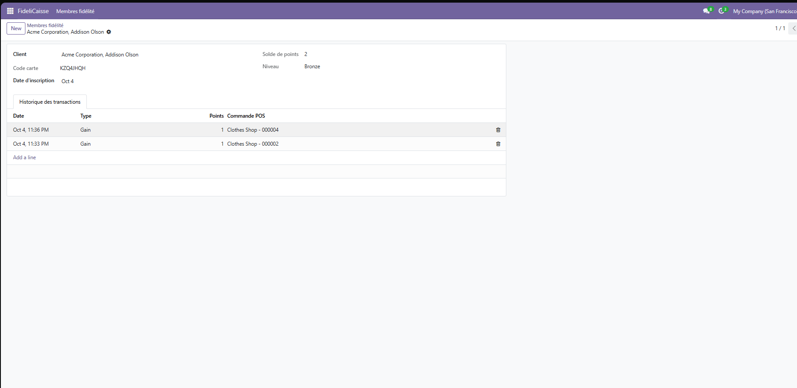
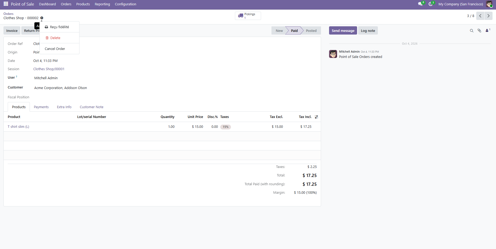
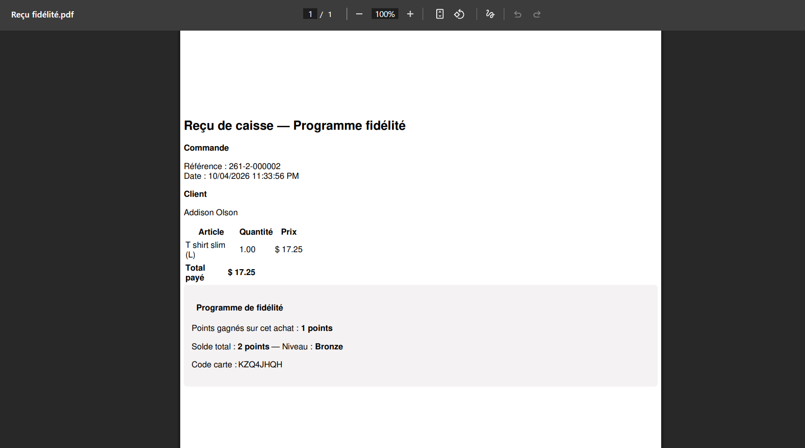
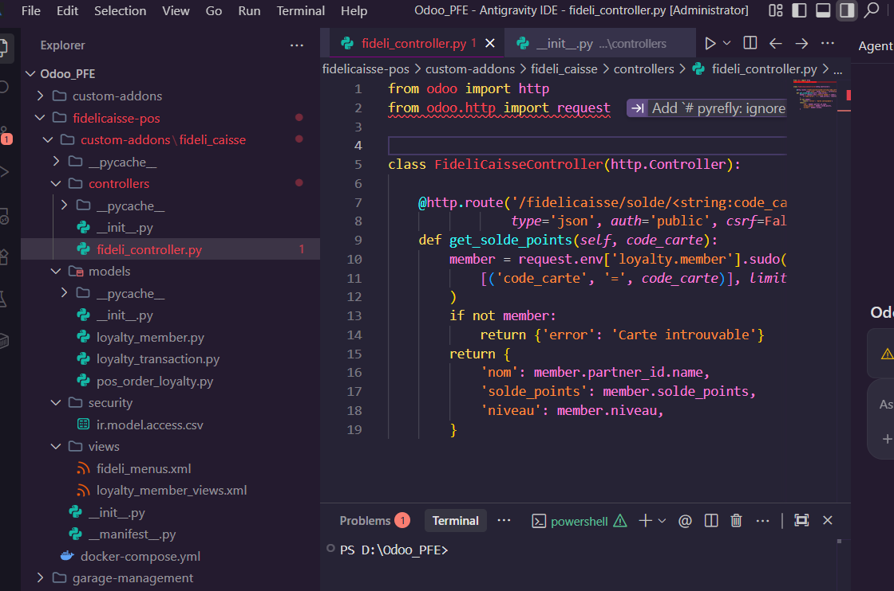

# 🎁 FideliCaisse — Loyalty Program for Odoo 19 Point of Sale

> Personal project built to go deeper into Odoo development: the **Point of Sale** module, **native web controllers** (no external app), and **automated tests**. It complements my first project, [Garage Management](https://github.com/Houssam265/garage-management-odoo), which focused on back-office workflows and XML-RPC integration.


---

## 📋 Overview

FideliCaisse adds a loyalty program on top of Odoo's Point of Sale. When a cashier attaches a customer who owns a loyalty card to an order, points are credited **automatically** once the order is paid. Customers can check their balance through a JSON route and a public web page, both served directly by Odoo.

## ✨ Features

- **Loyalty cards** (`loyalty.member`): auto-generated 8-character card code, computed points balance, automatic level (Bronze / Silver / Gold)
- **Points ledger** (`loyalty.transaction`): every gain or use is a traceable line, linked to the originating POS order
- **POS integration**: `pos.order` is extended so a paid order credits points (1 point per 10 currency units), with a guard flag that prevents double-crediting when Odoo writes the same order several times
- **Role-based access**: *Cashier* (read-only on members) and *Loyalty manager* (full access), using Odoo 19's `res.groups.privilege`
- **QWeb PDF receipt** printable from a POS order: purchase detail + points earned + total balance + level
- **Native JSON route**: `POST /fidelicaisse/solde/<card_code>` (`type='jsonrpc'`)
- **Native public page**: `GET /fidelicaisse/carte?code=<card_code>` rendered by a QWeb template
- **Automated tests** with `TransactionCase` and `HttpCase`

## 🏗️ Architecture

```
 Cashier ──► Odoo POS ──paid order──► pos.order (extended)
                                          │ creates
                                          ▼
                              loyalty.transaction ──► loyalty.member
                                                          │ balance, level
   Customer ──► /fidelicaisse/carte, /fidelicaisse/solde/<code> ◄─┘
                (native Odoo controllers, no external app)
```

Unlike Garage Management, where a separate Flask app reads Odoo through XML-RPC, here the code runs **inside** Odoo and exposes its own routes.

## 📸 Screenshots

| Loyalty member and points history | POS order with the loyalty receipt action |
|---|---|
|  |  |

| Loyalty PDF receipt | Native JSON route |
|---|---|
|  |  |

## 🚀 Installation

Prerequisite: [Docker Desktop](https://www.docker.com/products/docker-desktop/).

```bash
git clone https://github.com/Houssam265/fidelicaisse-pos.git
cd fidelicaisse-pos
docker compose up -d
```

1. Open [http://localhost:8071](http://localhost:8071) and create a database (e.g. `fideli_dev`, demo data enabled).
2. Install **Point of Sale** from *Apps*.
3. Enable developer mode, click *Update Apps List*, then install **FideliCaisse**.
4. Create a loyalty member from the **FideliCaisse** menu, then make a POS sale with that customer: points appear in the member's history.

### Try the API

```powershell
Invoke-RestMethod -Uri "http://localhost:8071/fidelicaisse/solde/<CARD_CODE>" -Method Post `
  -Body '{"jsonrpc": "2.0", "method": "call", "params": {}}' -ContentType "application/json"
```

or open `http://localhost:8071/fidelicaisse/carte?code=<CARD_CODE>` in a browser.

## 🧪 Tests

```bash
docker compose run --rm odoo odoo -d fideli_dev --db_host=db --db_user=odoo --db_password=odoo \
  -u fideli_caisse --test-enable --stop-after-init --log-level=test
```

Covered: card code generation, initial balance, gain and use of points, level change, public page (known code, unknown code, no code).

## 📁 Structure

```
fidelicaisse-pos/
├── docker-compose.yml
└── custom-addons/fideli_caisse/
    ├── models/        # loyalty.member, loyalty.transaction, pos.order extension
    ├── controllers/   # JSON route + public page
    ├── views/         # list/form views, menus, public QWeb page
    ├── security/      # groups and access rights
    ├── reports/       # QWeb PDF receipt
    └── tests/         # TransactionCase and HttpCase tests
```

## 🔭 Limitations and next steps

- Points are earned automatically, but **redeeming points as a discount at the register is not implemented yet**.
- The earn rate (1 point per 10 units) and level thresholds (200 / 500) are hard-coded; they could become settings.
- The POS-to-points hook is verified manually on real orders; an automated test on `pos.order` is still to add.

## 👤 Author

**Houssam Hariss** — Computer engineering student, ENSA Tétouan
[GitHub](https://github.com/Houssam265)

## 📄 License

LGPL-3, consistent with Odoo Community Edition.
